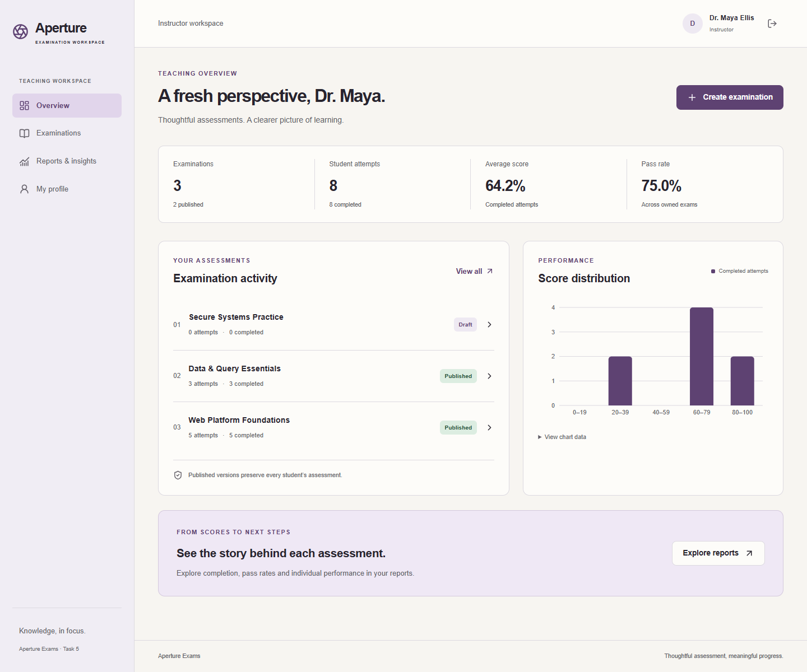

# Aperture Exams

A focused examination workspace for **Auspify Technologies Internship, Task 5**. Instructors design and publish assessments; students take timed examinations, recover saved work and receive trustworthy server-calculated results.

[Repository](https://github.com/Jaclyn25/online-examination-system) · [Validation workflow](https://github.com/Jaclyn25/online-examination-system/actions/workflows/ci.yml) · [Submission summary](submission/PROJECT-SUMMARY.md) · [Delivery record](submission/DELIVERY.md)



## Run with Docker

Requires Git and Docker Desktop with Linux containers. Run from the repository root:

```powershell
git clone https://github.com/Jaclyn25/online-examination-system.git
cd online-examination-system
powershell -NoProfile -ExecutionPolicy Bypass -File ./scripts/init-env.ps1
docker compose up --build --detach --wait --wait-timeout 180
docker compose ps
```

Open **[Aperture Exams at localhost:18082](http://127.0.0.1:18082)**. PostgreSQL uses loopback port **54331**; the API is internal. The `aperture` Compose project has its own database and session-key volumes. Library and Inventory ports and data are unaffected.

The initialization script generates random local secrets in ignored `.env` and preserves existing configuration. Sign in as **`instructor@aperture.test`**, using the `DEMO_INSTRUCTOR_PASSWORD` value from your local `.env`. No reusable password is committed. Students use **Create a student account** on the sign-in page. Public registration always creates a Student, regardless of extra role fields.

First startup applies EF migrations and seeds an empty database with **three fictional exams, two published versions, fourteen questions and six completed fictional attempts**. Historical fictional learners have no passwords and cannot sign in. Existing records are preserved. Browser tests and screenshot capture create additional fictional records.

## Included workflows

- **Identity:** student registration, login/logout, authenticated profile, instructor provisioning, role and ownership checks, password hashing, lockout, CSRF validation and rate limits.
- **Assessment studio:** validated title, instructions, duration and passing threshold; Draft/Published/Closed lifecycle; multiple-choice questions, distinct choices, exactly one correct answer, integer marks, editing, deletion and reordering.
- **Safe publishing:** immutable relational snapshots retain question content, choices, keys, scoring, duration and feedback policy for every attempt. Returning to Draft prepares a future version without rewriting history.
- **Student player:** instructions, one attempt per student/exam, durable answers, previous/next and question-map navigation, answer clearing, review flags, save state, server-aligned countdown and final confirmation.
- **Scoring:** server-only integer/decimal scoring, unanswered questions, exact pass boundaries, atomic finalization, duplicate submission replay and deadline enforcement. A background sweep finalizes disconnected attempts.
- **Results and insight:** student history, marks, percentage, pass/fail, completion time and permitted feedback; owned instructor metrics, distributions, per-exam reports and individual summaries.
- **Interface:** original responsive design, keyboard-accessible native controls, mobile navigation, loading/empty/error states, visible focus, reduced motion and chart data alternatives.

## Stack

| Layer | Implementation |
| --- | --- |
| API | ASP.NET Core 10, C#, ASP.NET Core Identity, EF Core 10, Npgsql, OpenAPI, JSON structured logging |
| Database | PostgreSQL 17, migrations, unique/check/FK constraints, transactions, row locks and immutability triggers |
| Web | React 19, TypeScript 5.9, Vite 7, Tailwind CSS 4, React Router 7 |
| State and forms | TanStack Query 5, React Hook Form 7, Zod 4 |
| Analytics | Recharts 3 with interactive tooltips and text alternatives |
| Verification | xUnit with real PostgreSQL, Vitest/RTL, Playwright, Docker smoke and restart checks |
| Delivery | Docker Compose, Nginx, GitHub Actions; no automatic deployment |

Exact frontend dependencies are locked in `frontend/package-lock.json`; .NET dependencies and tools are pinned in project files and `dotnet-tools.json`. Node 22.13+ or 24 LTS is supported; CI uses Node 24, Docker uses the maintained Node 22 build image.

## Native development and testing

Requires .NET SDK 10, Node and Docker/PostgreSQL. From the repository root:

```powershell
./scripts/init-env.ps1
docker compose up -d db
dotnet tool restore
./scripts/start-api.ps1
```

In another terminal:

```powershell
cd frontend
npm ci
npm run dev
```

Native web: [localhost:5175](http://127.0.0.1:5175). Native API: [localhost:5082/api/health](http://127.0.0.1:5082/api/health). Use the same origin consistently; browser cookies are host-scoped. [Setup, configuration and troubleshooting](docs/setup.md).

```powershell
./scripts/test.ps1
cd frontend
npm run typecheck
npm run build
npm run lint
npm test
npx playwright install chromium
npm run test:e2e
```

Playwright requires the native API running and starts Vite when necessary. For the Docker app, set `$env:E2E_BASE_URL='http://127.0.0.1:18082'` before running it. An installed Edge browser can be used locally with `$env:PLAYWRIGHT_CHANNEL='msedge'`.

**Verified:** 44 backend tests, 16 frontend tests and four browser flows pass. All four browser flows also pass against Docker. Production images build, all services become healthy, authenticated smoke checks pass and sessions survive API restart. [Actual evidence](submission/TEST-RESULTS.md) · [Coverage and commands](docs/testing.md).

## Documentation and delivery

[Architecture](docs/architecture.md) · [Database](docs/database.md) · [API](docs/api.md) · [Security model](docs/security.md) · [Setup](docs/setup.md) · [Screenshots](submission/SCREENSHOTS.md).

OpenAPI is available at [/openapi/v1.json](http://127.0.0.1:18082/openapi/v1.json). All writes require the antiforgery cookie plus the `X-CSRF-TOKEN` request token. API errors use HTTP status codes and safe problem details.

Generate a source-only ZIP and SHA-256 checksum after checking out the delivery commit:

```powershell
./scripts/package-source.ps1
```

The package uses `git archive`, includes committed documentation/screenshots/evidence and excludes local secrets, database volumes, dependencies, build outputs and browser traces. Nothing is submitted to Auspify automatically. The existing repository remains private; its visibility was not changed.

## Policy and limitations

- Multiple-choice, single-correct-answer exams only; one lifetime attempt per student/exam, including across republished versions. Retakes require a separate exam.
- Publishing makes an exam available immediately. Closing prevents new attempts; active attempts retain their original deadline. Scheduling, proctoring and randomized question banks are outside this task.
- Only confirmed saved answers are recoverable. Offline edits are not queued; the timer continues during disconnection. Flags are a local review aid and are not persisted across refreshes.
- Lists/reports are unpaginated for this internship dataset. Larger deployments need pagination, operational tuning and load testing.
- The delivered Compose profile is local HTTP on loopback with development-only demo provisioning. Public operation requires an explicitly managed HTTPS deployment, production credentials and key protection, trusted proxy configuration and backup/recovery procedures. None is deployed automatically.
- Email verification, password recovery, MFA and SSO are not included. Logout revokes all existing sessions for that account. Formal penetration testing and accessibility certification are not claimed.
