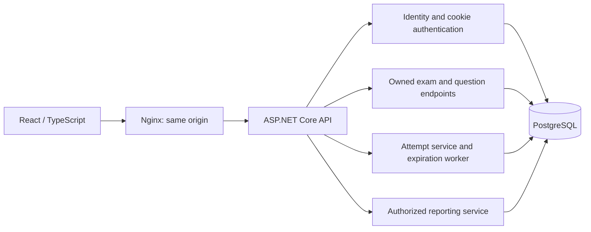

# Architecture

Aperture is an independent application. The Library and Inventory projects informed branch delivery, test separation, local container isolation and evidence packaging; their source code and repositories were not modified.

The API uses minimal endpoint groups and scoped services over one EF Core context. Identity stores accounts, roles, password hashes, lockout state and security stamps. Every protected resource derives the caller from authenticated claims. React Router separates student and instructor routes. TanStack Query owns server state; React Hook Form/Zod provide form feedback. The backend independently validates all consequential input.

## Publication and attempts

Draft questions and choices are editable. Publishing locks the exam row, verifies its revision and complete question configuration, creates a new version and cloned relational question/choice records, then changes status atomically. Published snapshots have no mutation endpoint, and database triggers reject updates/deletion. Every attempt refers to one immutable version. Draft changes and later publication never alter an earlier attempt's content or threshold.

One unique `(ExamId, StudentId)` pair defines the attempt policy. Starting locks the exam row before checking availability and existing attempts, preventing parallel duplicate starts. Restoring and saving lock the attempt row. Revision numbers reject stale edits and cross-tab answer overwrites rather than silently accepting old state.

## Scoring and deadline concurrency

All attempt operations use PostgreSQL transactions. Finalization acquires `SELECT ... FOR UPDATE` on the attempt and reads its state after obtaining that lock. A save, submission, expiration sweep or retry therefore sees one serialized state. Finalization creates the result and changes attempt status/completion time in the same transaction. A repeated submission returns the existing result. A unique result key and immutability trigger provide additional protection.

The injectable `TimeProvider` supplies UTC. At `now >= deadline`, answers are rejected and the saved attempt is finalized as Expired, with completion time equal to the deadline. Choice validation is followed by another deadline check before accepting a save. A five-second background sweep processes up to 100 expired attempts per sweep; reads/reporting also finalize due attempts. Restarting the API catches up expired attempts.

Marks are positive integers, capped at 1,000 per question and 100 questions per exam. Possible marks therefore stay at or below 100,000. Percentage is `Round(earned * 100m / total, 2, AwayFromZero)`. Pass/fail uses `earned * 100m >= passingPercentage * total`, without rounded percentages. Missing/cleared answers earn zero.

Reporting first finalizes due owned attempts, then uses a repeatable-read snapshot for instructor aggregates and detail rows. Averages and pass rates use completed attempts only. Each report request has its own snapshot; independently opened pages can reflect later activity.

## Runtime and references

Compose isolates the `aperture` network, database and data-protection volumes. Only Nginx and PostgreSQL have loopback-published ports. API health checks run the application's dedicated health probe. The runtime API uses the image's non-root account, a read-only root filesystem and writable key/tmp mounts. Nginx serves the production bundle and proxies API/OpenAPI requests. There is no deployment job.

[.NET support policy](https://dotnet.microsoft.com/en-us/platform/support/policy/dotnet-core), [Npgsql EF Core 10](https://www.npgsql.org/efcore/release-notes/10.0.html), [Node release schedule](https://github.com/nodejs/Release), [PostgreSQL row locks](https://www.postgresql.org/docs/17/explicit-locking.html), [ASP.NET antiforgery](https://learn.microsoft.com/aspnet/core/security/anti-request-forgery).
