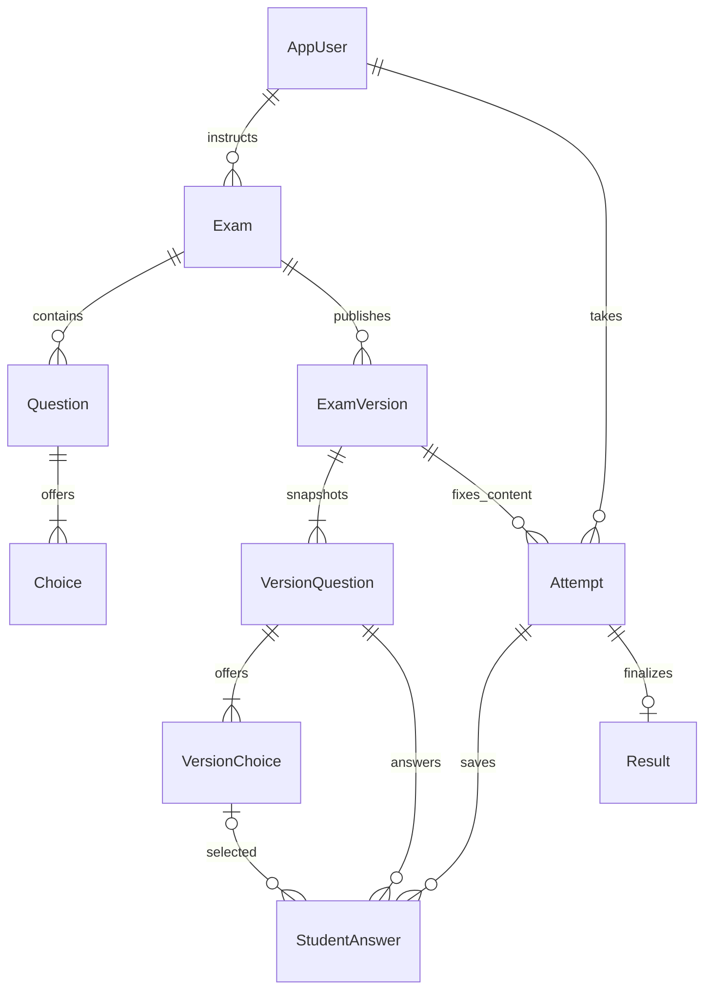

# Database design

EF Core migrations live in `backend/Aperture.Api/Data/Migrations`. Startup migration is explicitly enabled by local/CI configuration. All application timestamps use `DateTimeOffset`/PostgreSQL `timestamptz` in UTC. Display formatting uses the browser's timezone.

| Tables | Responsibility and constraints |
| --- | --- |
| `AspNetUsers`, `AspNetRoles`, `AspNetUserRoles`, claims/logins/tokens | Standard Identity schema; unique normalized account names, roles and role relationships; display name extension |
| `Exams` | Instructor FK, title/instructions, duration 1–240 minutes, passing percentage 0–100, Draft/Published/Closed check, revision, created time; owner/status index |
| `Questions` | Exam FK, text, integer marks 1–1000, positive ordered position; unique exam/position |
| `Choices` | Question FK, text, ordered position and correct flag; unique position; filtered unique index permits at most one correct choice |
| `ExamVersions` | Immutable title, instructions, duration, threshold, feedback policy, publication timestamp; unique exam/version number |
| `VersionQuestions`, `VersionChoices` | Immutable question and choice snapshots, ordered keys, marks and correct flags; restricted FKs and correct-answer/position uniqueness |
| `Attempts` | Student, exam and version FKs; unique student/exam; start/deadline/completion UTC, status and revision; status/deadline sweep index |
| `StudentAnswers` | Composite attempt/question PK, nullable selected choice FK and saved timestamp; one persisted selection per question |
| `Results` | One-to-one attempt PK/FK; earned/possible marks, decimal percentage, pass/fail and correct/incorrect/unanswered counts |

Draft deletion cascades only into its choices. Published content, attempts and results use restrictive relationships. Version tables deliberately duplicate authored text to preserve historical meaning. This is controlled snapshotting, rather than mutable references to current answer keys.

Database triggers reject version/result mutation, changes to finalized attempt identity/state, answer writes with invalid attempt/question/choice membership or timestamps, and deletion of finalized answers. Business validation additionally requires exactly one correct answer, 2–8 distinct choices, bounded text and no more than 100 questions before publishing.

Migrations `HistoryGuards` and `ProtectAnswerDeletion` install database behavior without resetting data. The latter is a forward migration, including for databases already initialized during development. Application and database operations commit together; no client-supplied score is stored.

Seeding runs only in Development with both demo and seed flags enabled and an empty exam catalog. The fictional starter data includes two published assessments, one draft, fourteen authored questions, eleven snapshotted questions and six server-scored historical attempts. Historical learners are passwordless. Integration tests use uniquely named temporary PostgreSQL databases, apply the real migrations and drop only those test databases afterward.
